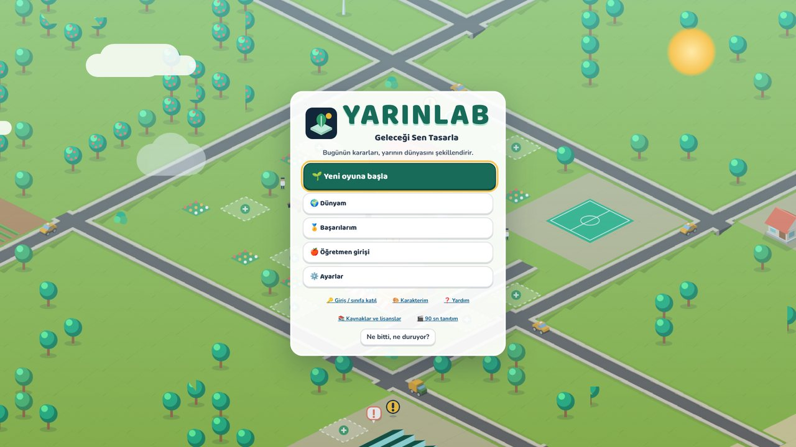
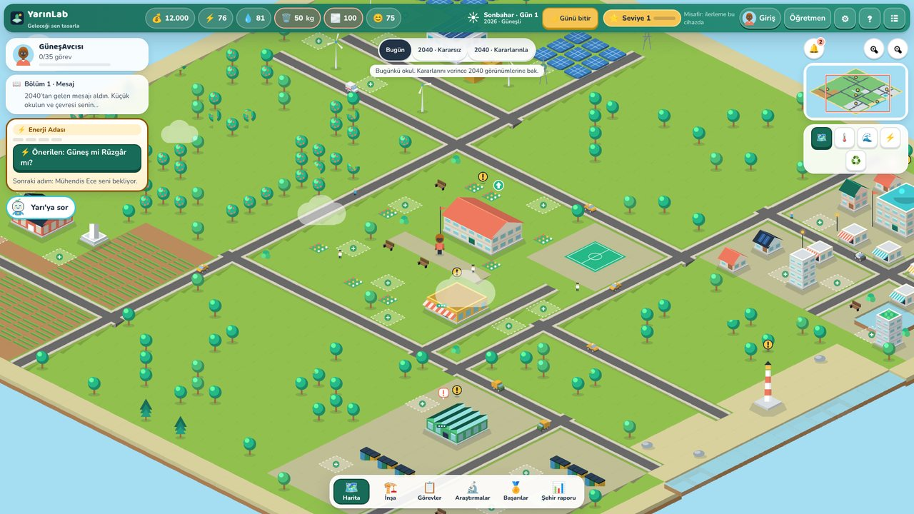
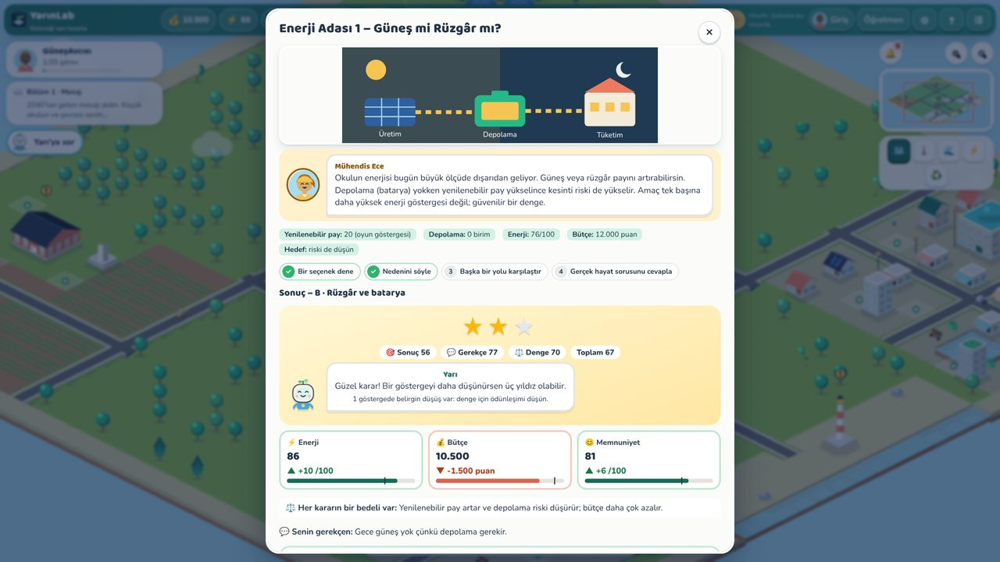
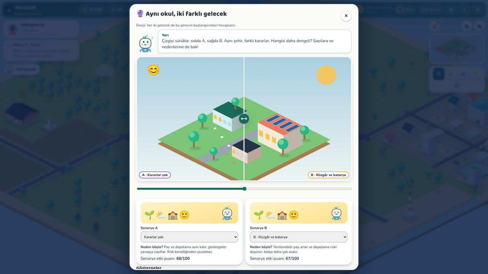
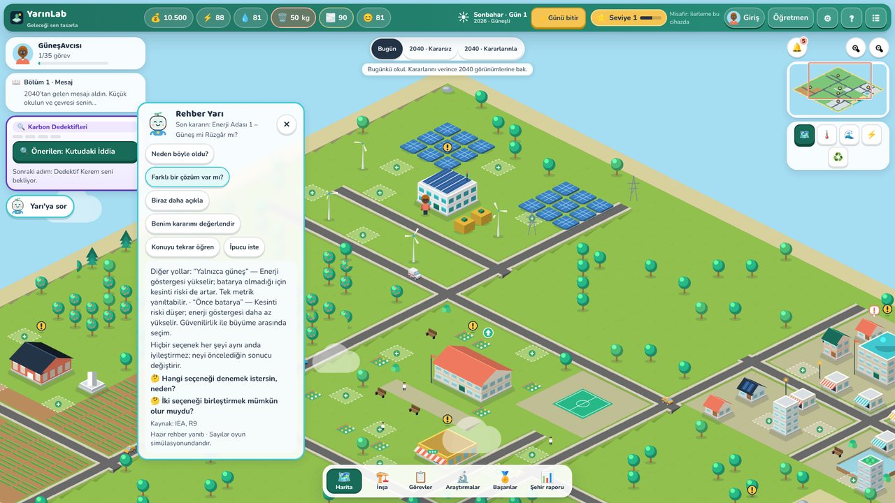
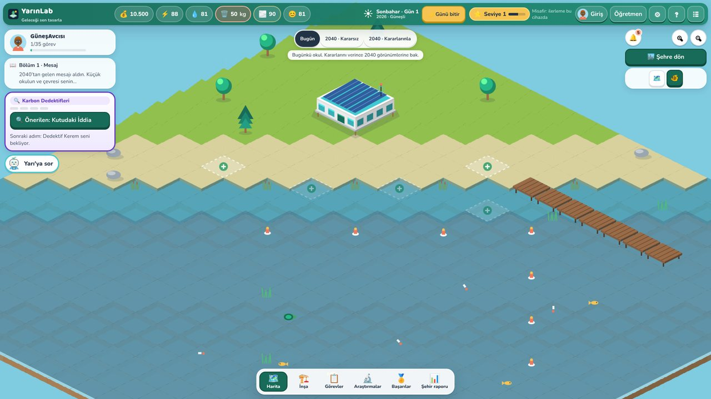

# YarınLab — Geleceği Sen Tasarla

*Bugünün kararları, yarının dünyasını şekillendirir.*

COP31 “İklim Değişikliği Odağında Eğitim” teması için 6-8. sınıflara yönelik, 2.5D izometrik, yapay zekâ destekli iklim eğitimi simülasyonu. Oyun 2026'da başlar. 2040'tan gelen bir öğrencinin mesajıyla oyuncu bir okulun ve çevresinin sorumluluğunu üstlenir. Yedi iklim probleminde karar verir, şehrini geliştirir ve kararlarının ortak bir şehir simülasyonundaki etkisini görür. Öğretmenler sınıf açar, görev atar ve kazanım raporlarını izler.

| | |
|---|---|
|  |  |
|  |  |
|  |  |

**Teknoloji:** Phaser 4 · React 19 · TypeScript · Vite · Fastify 5 · Prisma 6 · PostgreSQL 16 · Vitest · Playwright · Tiled JSON · Kenney Isometric (CC0)

## Neler çalışıyor (test edildi)
- **Yarın Şehri:** 40×40 izometrik şehir (merkezde okul kampüsü, kuzeyde enerji vadisi, doğuda şehir merkezi, batıda tarım, güneyde döngü atölyesi) ve ayrı bir kıyı haritası (iskele, koruma alanı, su altı katmanı). Binalar kodla üretilir; kampüs 4 seviyede gelişir. Bina durumları: üzerine gelme, seçili, geliştirilebilir, iskele/toz animasyonu, uyarı balonu; tıklayınca bilgi kartı. Canlı çevre: trafik (Kenney araçları), yürüyen öğrenciler, kuşlar, bulutlar, ağaç salınımı, gün/gece ve hava. Haritada oyuncu karakteri seçilen bölgeye yürür.
- **Oyun arayüzü:** başlık ekranı (canlı şehir üzerinde), karakter oluşturucu, Ada (2040'tan hologram), üst kaynak çubuğu, aktif görev kartı, mini harita, bildirim merkezi, harita katmanları (sıcaklık, sel, enerji ve atık akışı), alt dock ve çekmeceler; 7 animasyonlu modül sahnesi; sürüklenebilir “iki gelecek” dioraması; rehber Yarı (ipucu, neden, alternatif, açıkla, tekrar öğren, kararımı değerlendir). Müzik, ortam ve efekt sesleri ayrı ayarlanır. Tasarım sistemi: [docs/DESIGN_SYSTEM.md](docs/DESIGN_SYSTEM.md).
- **7 modül × 5 görev = 35 oynanabilir görev:** Enerji Adası, Karbon Dedektifleri, KrizKenti, Son Tabak, Mavi Nöbet, Döngü Ustaları, Gelecek Meclisi. Her görevde 3 karar yolu, karar vermeme seçeneği, ödünleşim, kavram yanılgısı işareti, kazanım, kaynak, transfer sorusu ve gerçek dünya etkinliği var. Görev zinciri ve Meclis kapıları bulunuyor. Hikâyenin dört bölümü ve göstergelere göre değişen üç 2040 sonu var.
- **Ortak şehir simülasyonu (deterministik):** tohumlu hava ve mevsim, saatlik enerji dengesi (güneş/rüzgâr/depolama/şebeke sınırı), 10 gösterge, modüller arası etkiler, nedenleri açıklanan olay günlüğü.
- **İnşa sistemi:** 15 yapı + 4 seviyeli kampüs, maliyet, bakım, kapasite ve kilitler. Yapılar haritada görünür.
- **Hesaplar ve kayıt:** öğretmen (e-posta) ve öğrenci (sınıf kodu + takma ad). Sunucuya otomatik kayıt, sürüm kilidi, çevrim dışı kuyruk ve geri yükleme.
- **Yapay zekâ:** İklim Öğretmeni, Senaryo Yönetmeni ve Öğretmen Asistanı. Sağlayıcıdan bağımsız arayüz (Anthropic adaptörü dahil). Yanıtlar doğrulanır; kota, bütçe ve hız sınırı uygulanır; her hata durumunda doğrulanmış yedek geri bildirim döner.
- **Öğretmen paneli (gerçek veri, 9 ekran):** genel bakış, sınıf, KVKK izin akışı, gruplar, görev atama, ilerleme, kazanım analizi, ön/son test, kavram yanılgısı raporu, gerekçeler, gerçek dünya ölçümleri, CSV/PDF, AI önerileri ve hesap ayarları (ad/parola).
- **Oyunlaştırma:** seviye, 12 baskısız rozet, puan dökümü (sonuç/gerekçe/denge). Sıralama, süre baskısı veya ücretli ödül yok.
- **Erişilebilirlik ve kalite:** klavye ile kullanım, odak yönetimi, axe (WCAG 2 AA) taraması, hareket azaltma, yazı boyutu, ses ve grafik ayarları, dokunmatik ve tablet görünümü, sıkı CSP.

Test sonuçları: [docs/TEST_RESULTS.md](docs/TEST_RESULTS.md). Yapılmayan ve doğrulanmayan işler: **[docs/KNOWN_ISSUES.md](docs/KNOWN_ISSUES.md)** (canlı yayın, canlı LLM çağrısı, gerçek cihaz ölçümü ve KVKK hukuki incelemesi yapılmadı).

## Hızlı başlangıç
```bash
npm ci
cp .env.example apps/server/.env
npm -w @yarinlab/server exec prisma migrate deploy
npm run dev            # http://localhost:5173
```
Ayrıntı: [docs/SETUP.md](docs/SETUP.md) · Docker: `docker compose up -d --build`

## Vercel'e yayınla (vercel.app)
1. Vercel'de **Add New → Project** ile bu depoyu içe aktarın (Framework: Other; ayarlar `vercel.json`'da).
2. **Storage → Neon (Postgres)** veri tabanını projeye bağlayın (`DATABASE_URL`, `DATABASE_URL_UNPOOLED` otomatik gelir).
3. Ortam değişkeni `COOKIE_SECURE=true` ekleyin (isteğe bağlı: `AI_PROVIDER=anthropic`, `ANTHROPIC_API_KEY`).
4. **Deploy** → `https://<proje>.vercel.app`. Tablolar derlemede otomatik oluşur. Ayrıntı ve sınırlar: [docs/DEPLOY.md](docs/DEPLOY.md#seçenek-c--vercel-vercelapp-tam-ürün-oyun--hesaplar--öğretmen-paneli).

## Belgeler
| Belge | İçerik |
|---|---|
| [docs/SETUP.md](docs/SETUP.md) | Kurulum, ortam değişkenleri, Docker, yedekleme, CI |
| [docs/ARCHITECTURE.md](docs/ARCHITECTURE.md) | Mimari, veri akışı, AI, güvenlik, veri modeli |
| [docs/STUDENT_GUIDE.md](docs/STUDENT_GUIDE.md) · [docs/TEACHER_GUIDE.md](docs/TEACHER_GUIDE.md) | Kullanıcı kılavuzları |
| [docs/SIMULATION_ASSUMPTIONS.md](docs/SIMULATION_ASSUMPTIONS.md) | Tüm katsayılar, varsayımlar ve bilimsel dayanaklar |
| [docs/sources/SOURCES.md](docs/sources/SOURCES.md) · [docs/licenses/licenses.md](docs/licenses/licenses.md) | Kaynaklar ve asset lisansları |
| [docs/KNOWN_ISSUES.md](docs/KNOWN_ISSUES.md) · [docs/TEST_RESULTS.md](docs/TEST_RESULTS.md) | Dürüstlük kaydı ve test sonuçları |
| [docs/DESIGN_SYSTEM.md](docs/DESIGN_SYSTEM.md) · [docs/ASSET_INVENTORY.md](docs/ASSET_INVENTORY.md) · [docs/GORSEL_UYUM.md](docs/GORSEL_UYUM.md) | Tasarım sistemi, görsel/ses varlıkları ve görsel tasarım promptu uyum tablosu |
| docs/PLAN.md, ROADMAP.md, ACCEPTANCE.md, decision-log/ | Creathon P0 dönemine ait tarihsel kayıtlar |

## Yapı
`packages/shared` (simülasyon, içerik, AI doğrulama) · `apps/web` (React + Phaser) · `apps/server` (Fastify + Prisma) · `apps/web/e2e` (Playwright) · `scripts/backup.sh` · `Dockerfile`, `docker-compose.yml`, `.github/workflows/ci.yml`

## Dürüstlük notu
Oyundaki değerler **simülasyon göstergeleridir**; gerçek saha ölçümü veya kanıtlanmış karbon azaltımı değildir. kg CO₂e hesaplanmaz, emisyon birimsiz bir endekstir. Öğrencilerden ad, e-posta, fotoğraf veya konum toplanmaz.
